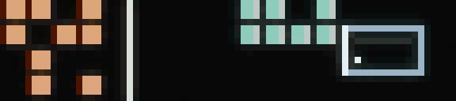

# Fold Echo

Fold a pixel sheet about horizontal and vertical creases until its ink matches a target silhouette.

Try a paper-folding puzzle without losing sight of the goal. The target stays fixed on the right while the ink on the left moves, so you can tell which fold brought the silhouettes closer.

## Apply a vertical crease

1. Look at the amber starting sheet and the pale target. Turn the wheel to position the crease; the rear identifies its direction and number.
2. Click to fold the far side toward the near side. If two inked cells meet, they occupy the same final cell.
3. Compare the changed silhouette with the target before selecting the next crease. The first clip shows the vertical fold on the opening puzzle.


## Finish with a horizontal fold

1. Turn through the remaining vertical positions to reach the horizontal creases. The guide line rotates across the sheet.
2. Click at the chosen position. Press **Start** to undo a fold if the shape moved the wrong way.
3. When the folded ink matches the target the rear reports **Matched**. Click again for the next puzzle. Hold **Start** to reset the current one.



## Example from the emulator

The opening target can be reached by folding at vertical crease four and horizontal crease two. A fold that would move ink outside the grid is rejected. Use undo to see which cells came from the far side.

## Run in the emulator

Open BUSY Bar Emulator. From this repository, run:

```sh
~/.busy-emulator/bin/busy-emulator dev --once
```

Press **Back** to exit.

The GIFs are excerpts from the emulator recording. Each front-display pixel is shown at 9× its original width and height. The end frames pause for reading.

[Full recording](media/controls.mp4) · [Rear display](screenshots/back-1.png) · [Firmware test](EMULATOR-QA.md) · [MIT license](LICENSE)
